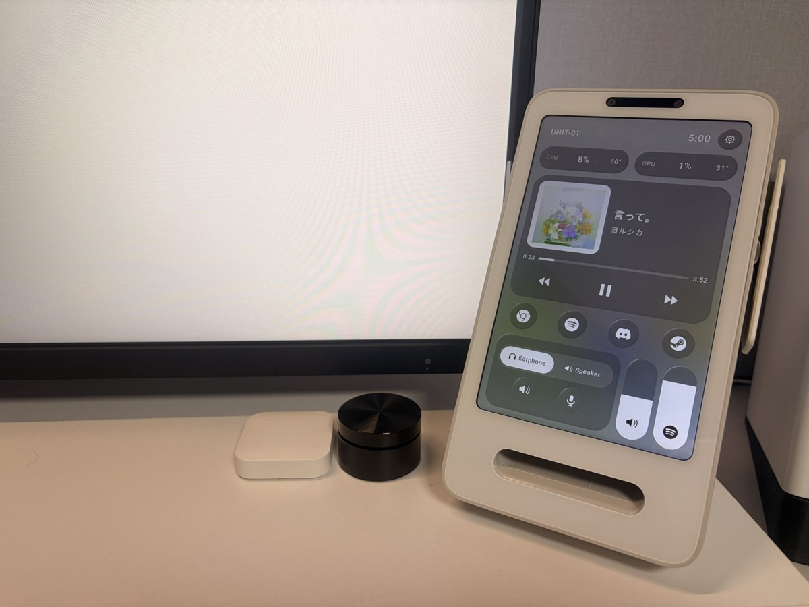
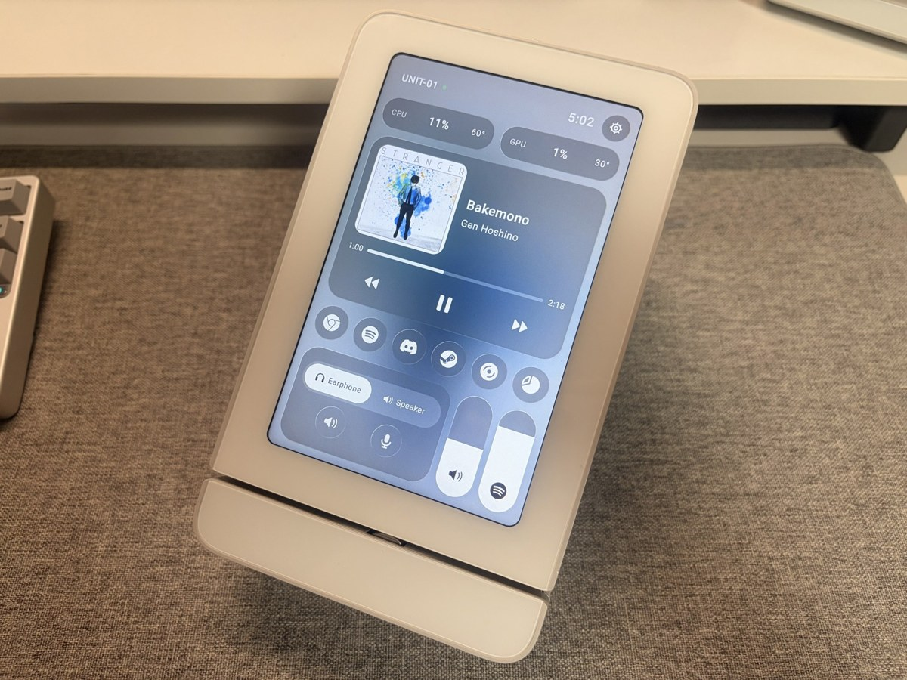
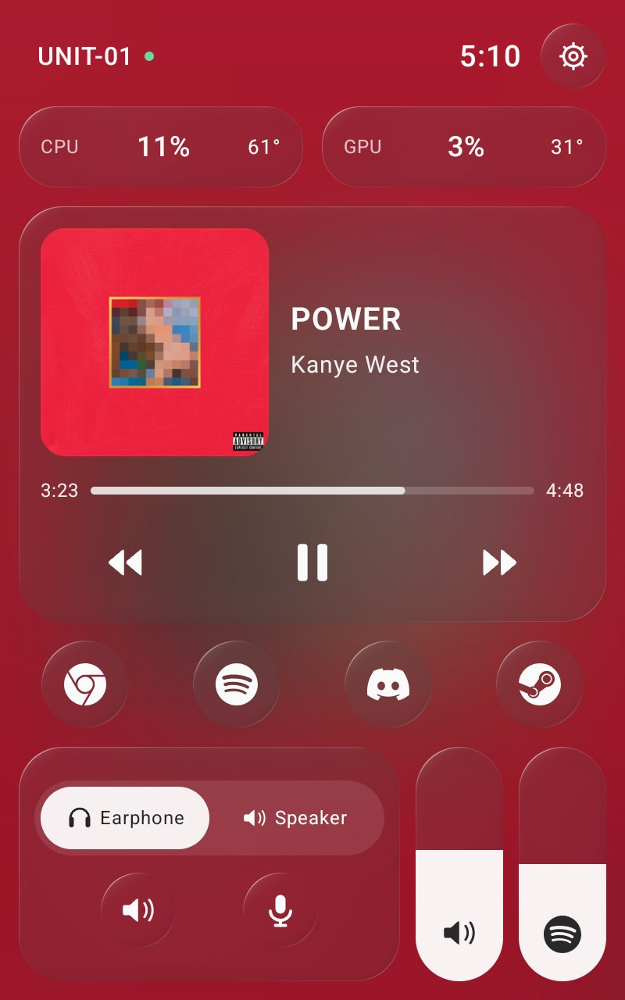
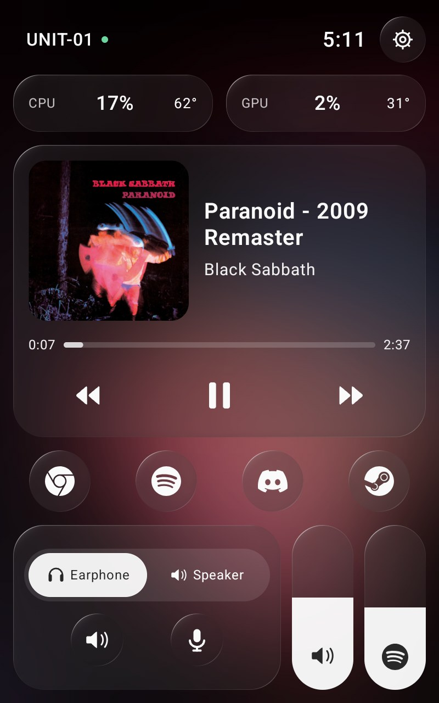
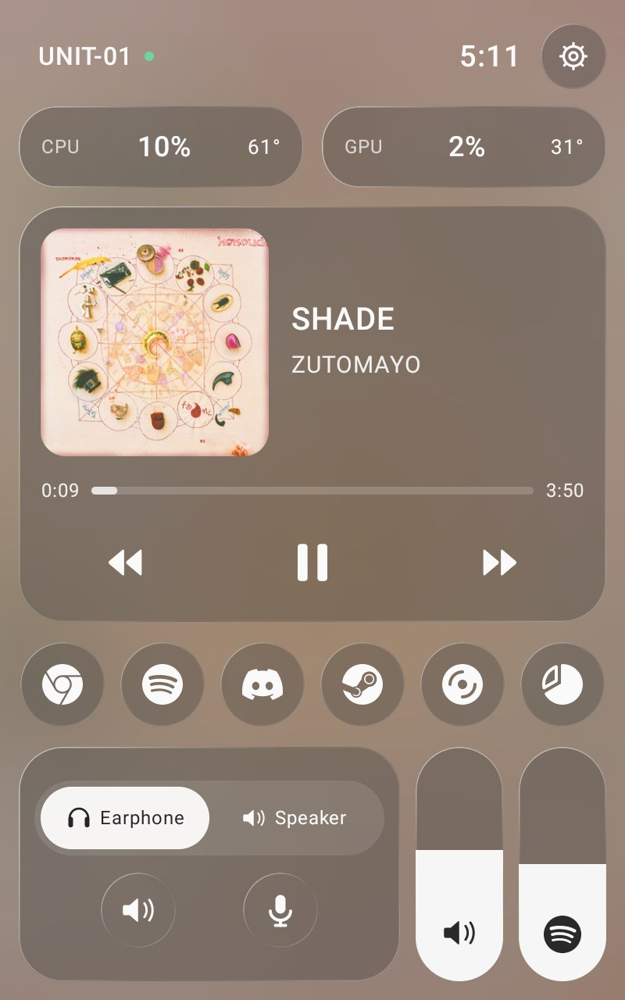
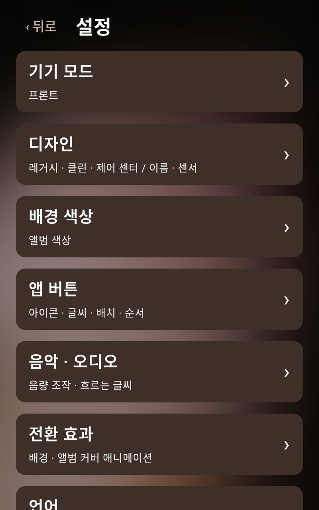
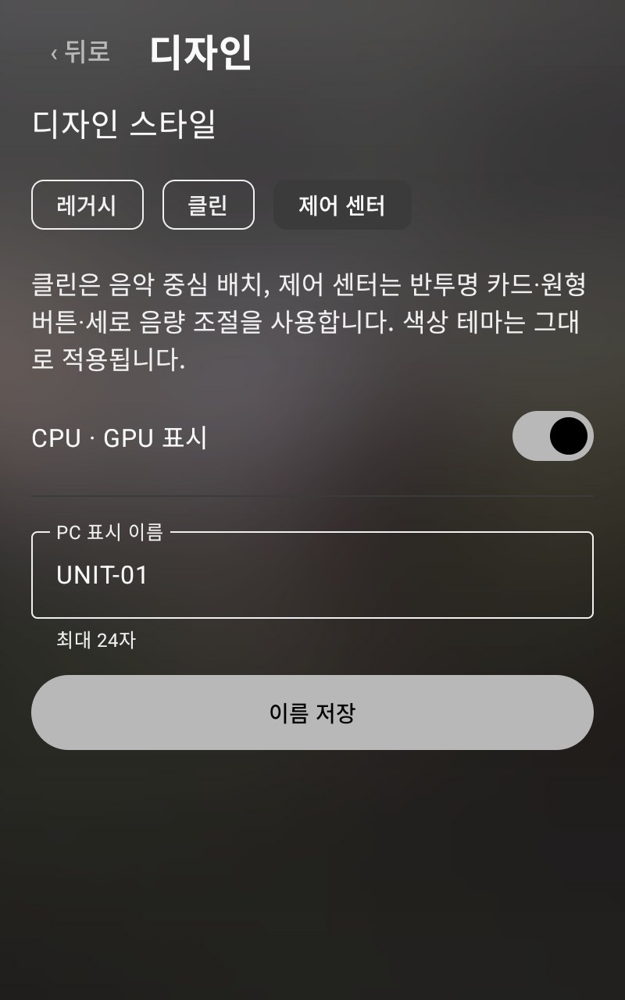
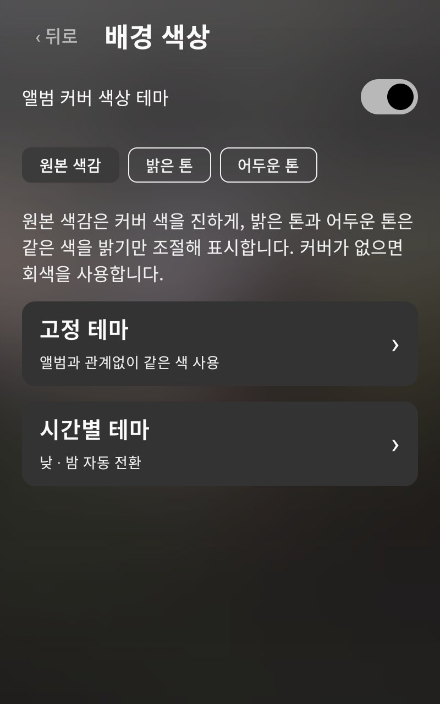
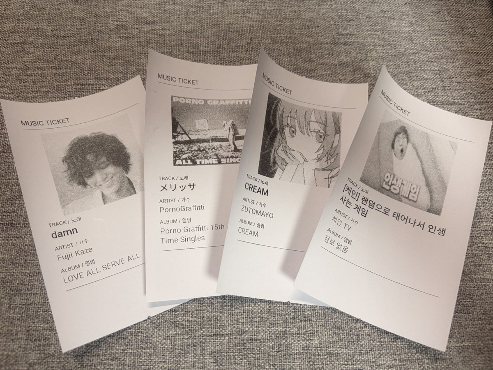
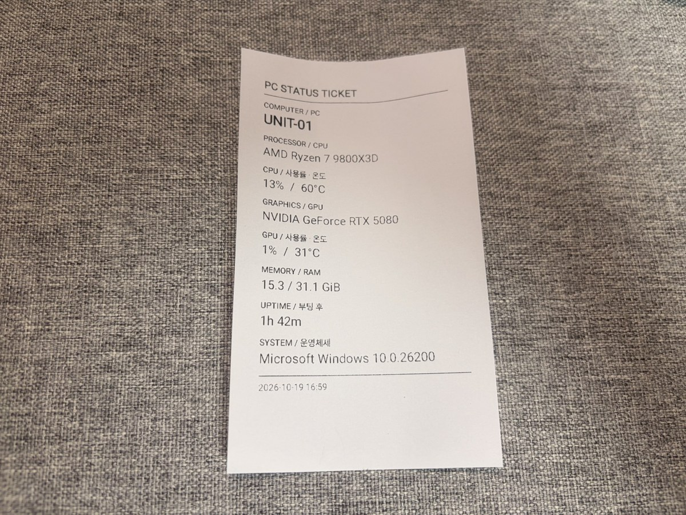

# Settings guide / 설정 가이드

[← 프로젝트 소개](README.md) · [다운로드](https://github.com/SFFworks/PC-dashboard/releases/tag/v0.9.25) · [변경 이력](CHANGELOG.md)

**Android 0.9.25 / Windows 0.9.6 기준입니다.** 아래 추천 설정은 설치 시 자동으로 적용되는 프리셋이 아닙니다. 앱에서 직접 선택하세요. 기존 앱 위에 업데이트하면 저장된 설정이 유지됩니다.

> **English:** Screenshots show customized settings, not the first-install defaults. To get this look: Settings → Design → Control; App buttons → Icons; Background → Album artwork colors → Original; optionally enable smooth theme/artwork transitions. Front uses four shortcuts; Terminal adds two ticket buttons with the separate printer service installed.

## 1. 실물과 화면

### 프론트 · 터미널

<table><tr><td width="50%"> 프론트 2세대</td><td width="50%"> 터미널 1세대</td></tr></table>

### 제어센터와 앨범 색상

<table><tr><td width="33%"></td><td width="33%"></td><td width="33%"></td></tr></table>

프론트는 앱 4개, 터미널은 앱 4개와 음악·PC 티켓 버튼 2개를 표시한 예시입니다. 커버와 선택한 톤에 따라 색이 달라집니다. 실사와 캡처의 색은 기기 화면·촬영 환경에 따라 다르게 보일 수 있습니다.

## 2. 사진처럼 설정하기

먼저 PC 프로그램과 Android 앱을 설치하고 같은 LAN/Wi-Fi에서 PC 검색·페어링을 완료하세요. 메인 화면 오른쪽 위 톱니바퀴를 누르면 설정이 열립니다.

| 순서 | 메뉴 | 추천 선택 | 달라지는 점 |
|---|---|---|---|
| 1 | 설정 → 기기 모드 | 사용하는 기기에 맞춰 프론트 또는 터미널 | 앱 버튼과 인쇄 기능 구성 |
| 2 | 설정 → 디자인 | **제어 센터** | 유리 카드·원형 버튼·세로 음량 슬라이더 |
| 3 | 설정 → 앱 버튼 | **아이콘**, 기본 배치 | 프론트 4개 / 터미널 6개 |
| 4 | 설정 → 배경 색상 | **앨범 커버 색상 테마 켜기 → 원본 색감** | 재생 중인 커버의 색을 배경에 반영 |
| 5 | 설정 → 전환 효과 | 배경 색상·앨범 커버 부드럽게 전환 켜기 | 곡 전환 시 색상·이미지 페이드 |
| 6 | 설정 → 전환 효과 | 유리 굴절 효과 켜기 | 제어센터의 유리 표현 |
| 7 | 설정 → 음악 · 오디오 | 앱 음량 슬라이더 켜기 → Spotify 또는 Discord | 전체 음량과 선택 앱 음량을 각각 조절 |

CPU·GPU 수치가 필요하면 디자인에서 표시를 켜두세요. 음악에 집중하고 싶으면 끌 수 있습니다. 이름은 디자인의 **PC 표시 이름**에 입력한 뒤 **이름 저장**을 누릅니다. 예시의 `UNIT-01`은 사용자가 지정한 이름입니다.

전환 효과는 각각 선택 사항입니다. 사용 중 버벅임이 느껴지면 두 전환 효과와 유리 효과를 하나씩 꺼서 비교하세요. 모든 기기에서 같은 성능을 보장하는 설정은 아닙니다.

## 3. 처음 설치했을 때의 기본값

| 항목 | 기본값 |
|---|---|
| 디자인 | 레거시 |
| 고정 테마 | 기본: 어두운 배경과 파란 포인트 |
| PC 표시 이름 | MAIN PC |
| 언어 | 메인 영어 / 설정 한국어 |
| 앱 버튼 | Chrome·Spotify·Discord·Steam, 글씨 표시 |
| 확장 배치 | 꺼짐: 프론트·레거시는 2×2 |
| CPU·GPU 표시 | 켜짐 |
| 음량 조작 | 레거시 − / ＋ 버튼 |
| 앨범 색상 / 시간별 테마 | 둘 다 꺼짐 |
| 배경·커버 부드러운 전환 | 둘 다 꺼짐 |
| 흐르는 글씨 | 꺼짐 |
| 기기 모드 | 자동: 프린터 서비스 설치 여부에 따라 판단 |
| 프린터 사용 | 켜짐으로 저장되며 터미널 모드일 때 적용 |
| 유리 굴절 | 켜짐, 제어센터에서 적용 |
| 앱 음량 | 켜짐·Spotify 선택, 제어센터에서 적용 |

처음에는 PC 연결 정보가 비어 있습니다. PC 검색과 토큰을 이용해 연결하세요. 기기 모드를 한 번 직접 선택한 뒤에는 그 선택이 저장됩니다.

## 4. 각 설정은 어디에 있나요?

아래쪽 **언어 / PC 연결** 메뉴는 스크롤하면 보입니다. 캡처는 이미 설정한 기기의 예시입니다.

| 메뉴 | 설정할 수 있는 내용 |
|---|---|
| 기기 모드 | 프론트·터미널 선택, 터미널 프린터 사용 여부 |
| 디자인 | 레거시·클린·제어센터, CPU·GPU 표시, PC 표시 이름 |
| 배경 색상 | 앨범 연동과 3가지 톤, 고정 테마, 낮·밤 시간별 테마 |
| 앱 버튼 | 글씨·아이콘, 기본·확장 배치, 버튼별 표시·순서·숨김 |
| 음악 · 오디오 | 레거시 음량 버튼·슬라이더, 제어센터 앱 음량 대상, 흐르는 글씨 |
| 전환 효과 | 배경 색상 전환, 앨범 커버 전환, 제어센터 유리 굴절 |
| 언어 | 메인 화면과 설정 화면의 언어를 각각 선택 |
| PC 연결 | PC 검색·페어링, 수동 연결, 연결·센서·드라이버·오디오 진단 |

### 디자인과 배경

<table><tr><td width="50%"></td><td width="50%"></td></tr></table>

- **레거시:** 기존 대시보드 배치. 음량은 버튼 또는 가로 슬라이더를 선택합니다.
- **클린:** 음악 중심 배치와 가로 음량 슬라이더.
- **제어센터:** 반투명 카드·원형 버튼·세로 음량 슬라이더. 앱별 음량은 이 디자인에서 사용합니다.
- **앨범 원본 색감:** 커버의 색을 더 풍부하게 반영합니다. 커버를 그대로 복사하는 의미는 아닙니다.
- **밝은 톤 / 어두운 톤:** 앨범 색상을 바탕으로 밝기를 조절합니다. 커버가 없으면 회색으로 표시합니다.
- **고정 테마:** 음악과 관계없이 같은 색을 유지합니다. 하우징과 어울리는 옅은 색은 웜 라이트 그레이, 어두운 색은 다크 그레이로 시작해볼 수 있습니다.
- **시간별 테마:** 낮·밤 시작 시각과 테마를 선택합니다. 기본 예약값은 08:00 웜 라이트 그레이 / 22:00 다크 그레이이며, 자동 전환을 켜야 적용됩니다.

앨범 연동과 시간별 테마는 동시에 켜는 방식이 아닙니다. 고정 테마를 고르면 앨범 연동과 시간별 전환이 꺼집니다. 유리 효과는 Android 11·12에서 호환 표현, Android 13 이상에서 GPU 굴절을 사용합니다.

## 5. 앱 버튼과 음량

| 구성 | 기본 배치 | 확장 배치 |
|---|---|---|
| 프론트 | 앱 4개 | 앱 8개·4×2 |
| 터미널 + 프린터 | 앱 4개 + 티켓 2개 = 6개 | 앱 6개 + 티켓 2개 = 8개·4×2 |

제어센터의 기본 버튼은 한 줄로 표시됩니다. 레거시의 기본 프론트 배치는 2×2입니다. 작은 화면에서는 버튼이 늘어날수록 음악 영역이 줄어들 수 있습니다.

Android에서는 표시 방식·순서·숨김을, **PC 프로그램 → 앱 버튼**에서는 앱 이름·프로그램 위치·실행 인수·아이콘을 지정합니다. 실행 인수는 해당 프로그램에 필요한 경우만 입력하세요. PC 설정 저장까지 완료해야 앱 실행 버튼을 사용할 수 있습니다.

앱 음량은 PC에 오디오 세션이 있어야 동작합니다. Spotify나 Discord에서 먼저 소리를 재생한 뒤 선택하세요. **대기 중**이라면 앱이 꺼져 있거나 소리 세션이 아직 없을 수 있습니다. 전체 음량·마이크 입력과는 별개입니다. 이어폰·스피커 전환은 탭과 좌우 드래그를 모두 지원합니다.

## 6. 터미널 티켓 출력

1. [Releases](https://github.com/SFFworks/PC-dashboard/releases/tag/v0.9.25)에서 `Toss-Printer-Service-1.5.apk`를 받아 **터미널에** 설치합니다.
2. 대시보드의 **설정 → 기기 모드 → 터미널 → 프린터 사용**을 켭니다.
3. 음악 티켓 또는 PC 상태 티켓 버튼을 누르면 미리보기 없이 한 장 출력합니다.

프린터 서비스는 커뮤니티 유저가 제작한 별도 앱입니다. 프론트에는 필요 없으며, 이미 출력된다면 다시 설치하지 않아도 됩니다.

<table><tr><td width="50%"> 음악 티켓: 커버·곡명·가수·앨범</td><td width="50%"> PC 티켓: 모델·사용률·온도·RAM·가동 시간·OS</td></tr></table>

## 7. 처음 연결할 때 확인할 점

- Android 앱과 Windows 프로그램을 모두 설치하고 같은 LAN/Wi-Fi에 연결하세요.
- PC 프로그램에서 스피커·이어폰 장치를 지정하고 저장하세요. 센서에 따라 관리자 권한과 호환 드라이버가 필요할 수 있습니다.
- 앱별 음량·커버 재시도·상세 PC 티켓까지 사용하려면 현재 배포된 PC 0.9.6을 권장합니다.
- 앱 실행 후 저장한 PC로 재연결합니다. Android 부팅 직후 앱을 자동으로 여는 키오스크 기능은 제공하지 않습니다.
- 해결되지 않으면 PC 연결의 진단을 확인하고 [Issues](https://github.com/SFFworks/PC-dashboard/issues)에 기기·OS·앱 버전과 재현 순서를 남겨주세요. API 토큰은 가려주세요.
